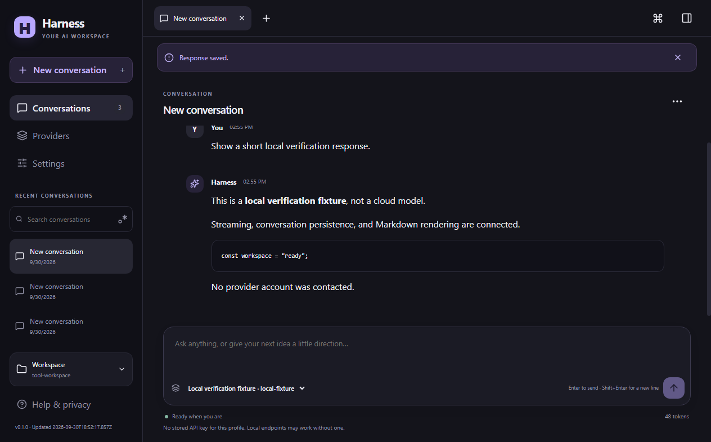
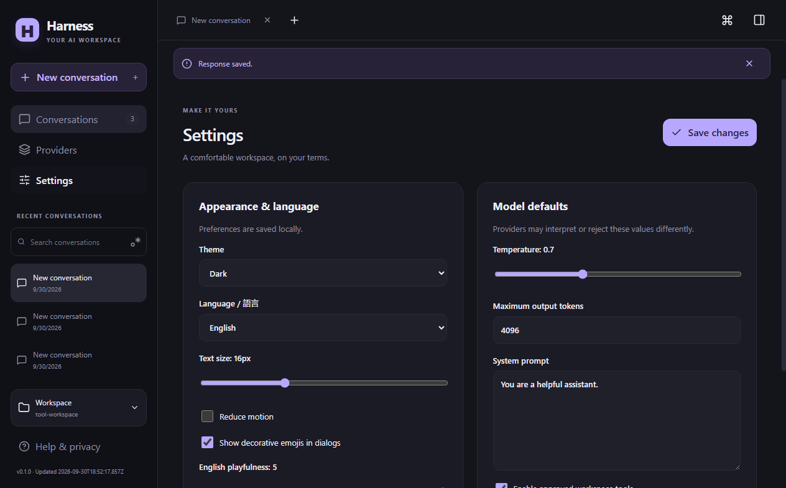
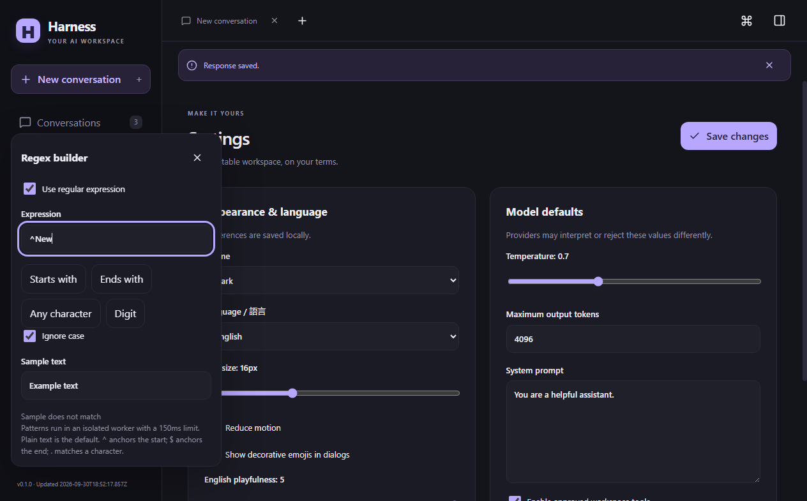

# Harness evidence gallery

This public gallery contains three reviewed captures from the Harness desktop application. The images show local fixture data only. They do not establish live provider compatibility, installer execution, exhaustive accessibility compliance, or completion of the broader product roadmap.

## Captures

| Screen | State | Capture |
| --- | --- | --- |
| Conversation | Completed local fixture response in dark theme |  |
| Settings | Saved appearance and model defaults in dark theme |  |
| Search | Regular expression builder open over settings |  |

All images are 1264 × 785 pixels at scale 1. Their original PNG bytes are preserved. The manifest at [evidence/inventory.json](evidence/inventory.json) records each capture SHA-256, the packaged executable SHA-256, the source commit, the interaction receipt hash, and the validated UTC capture timestamp.

## Privacy and provenance

The captures use an isolated profile and local protocol fixture. No provider account was contacted, and no real provider key, private user file, or unrelated desktop content appears. Capture timestamps come from the validated capture inventory; no date is inferred from filenames or file timestamps.

The source application is tracked separately at [Ding-Ding-Projects/harness](https://github.com/Ding-Ding-Projects/harness). This gallery contains evidence only and does not mirror its source code.

## Scope and limitations

This is a static evidence gallery. It does not implement the broader application's language, personalization, search, export, notification, appearance, or live status controls. The shared Status Hub could not be reached from the publishing session. The available Material Designer creation and export flow was not exposed in that session, so the gallery uses a small semantic static layout. These limits are stated here rather than implying full application or design-system conformance.

The captures document the packaged runtime built from source commit `c028c39eb07c55d84dcac937d438a05073d42c46`. Later documentation commits did not change that packaged runtime.
